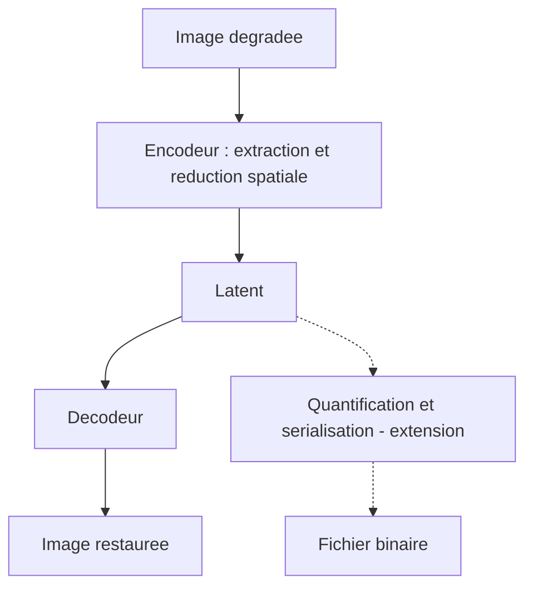
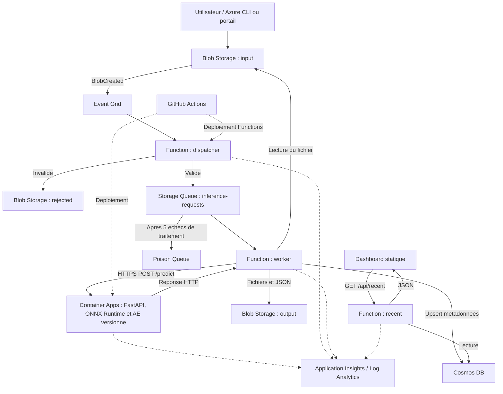

# SmartDoc

Service cloud événementiel de restauration et de compression neuronale de documents numérisés.

Projet de synthèse - Systèmes distribués et IA, ECE, 2026–2027.

## 1. Présentation du projet

SmartDoc s'adresse à des organisations qui numérisent et archivent des documents : factures, lettres, formulaires ou contrats. Des défauts de numérisation (bruit, flou léger, contraste insuffisant) peuvent réduire leur lisibilité ; leur archivage peut également nécessiter une représentation plus compacte.

Le service reçoit une image dans Azure Blob Storage, la valide, déclenche automatiquement son traitement par un modèle de Deep Learning, conserve les résultats et actualise un tableau de bord. Il est déployé sur Microsoft Azure, avec une architecture événementielle, des reprises automatiques, de l'observabilité et un pipeline CI/CD.

L'équipe développe et entraîne un seul modèle : un autoencodeur (AE) convolutionnel. L'encodeur réduit l'image à une représentation compacte, appelée latent. Le décodeur reconstruit l'image propre à partir du latent.

La question expérimentale est la suivante : comment la dimension du latent influence-t-elle la fidélité de restauration, la compacité de la représentation et le coût de l'inférence ?

### Périmètre

| Niveau | Fonctionnalités |
| --- | --- |
| Socle cloud | Pipeline événementiel complet, API conteneurisée, persistance, dashboard, CI/CD, sécurité, observabilité et coûts. |
| Socle ML | Un AE entraîné pour restaurer des images documentaires, évalué pour deux ou trois dimensions du latent, comparé à des baselines naïves et exporté en ONNX. |
| Extension prioritaire | Compression neuronale réelle : quantification, fichier binaire décodable et comparaison aux codecs classiques. |
| Extension reportée | Second modèle, un Variational Autoencoder (VAE), servi comme révision v2 de l'API pour le test A/B du sujet. Il n'est pas prévu pour l'instant. |
| Bonus du sujet | Test A/B de révisions, test de charge, infrastructure as code (Bicep), selon le temps disponible. |

La restauration est la fonctionnalité minimale du produit. La compression est une extension du produit et ne constitue pas à elle seule un bonus du barème. Le modèle ne doit pas retarder la mise en place du socle cloud. Aucun PDF, OCR de production, service d'entraînement cloud ou système d'authentification utilisateur complet n'est prévu dans la première version.

## 2. Architecture Machine Learning

### Données

L'équipe entraîne l'AE sur des couples `(image dégradée, image propre)` en niveaux de gris. Les documents propres proviennent de sources ouvertes dont la licence sera documentée, ou de documents synthétiques dont le texte et les mises en page sont générés localement.

Dégradations initiales : bruit numérique, flou léger et contraste variable. Les taches peuvent être ajoutées ensuite. Les transformations sont reproductibles et peuvent être générées à la volée. Le dataset peut dépasser 80 Mo. La séparation entraînement/validation/test est réalisée par document source avant le découpage et les augmentations, afin d'éviter les fuites de données.

Hypothèse initiale : patches de 128 × 128 pixels, un canal, normalisés dans [0, 1]. L'API accepte des images de dimensions bornées, les découpe si nécessaire et réassemble les sorties. La taille maximale réellement acceptée sera fixée après mesure sur le CPU cible. Les pages haute résolution ne sont pas une exigence de la première version : il ne faut pas écraser une page entière en 128 × 128 au risque de rendre le texte illisible.

### Architecture du modèle



L'architecture de référence est un petit encodeur convolutionnel suivi d'un décodeur symétrique. Le bottleneck les sépare : c'est le point le plus étroit du réseau, où se trouve le latent. Aucune connexion de saut ne contourne le bottleneck. Le latent doit suffire à reconstruire l'image, parce que l'extension compression n'enregistre que lui.

Le modèle est un CNN (réseau convolutionnel) parce que les caractères, les contours et le bruit sont des structures locales. Un CNN léger est simple à entraîner, à exporter et à mesurer sur CPU. Le sujet n'impose pas ce choix.

L'encodeur `E` calcule le latent `z = E(x_degrade)`, puis le décodeur `D` reconstruit `x_reconstruit = D(z)`. L'objectif initial est l'erreur quadratique moyenne (MSE) entre `x_reconstruit` et l'image propre. L'inférence est déterministe : la même image donne la même sortie, y compris quand le worker relance un traitement.

### Évaluation

L'AE est entraîné une fois par dimension du latent comparée. Toutes ces variantes utilisent les mêmes splits, les mêmes dégradations de test et les mêmes conventions de mesure. L'équipe mesure et documente le nombre de paramètres et le coût de calcul de chaque variante.

| Mesure | Usage |
| --- | --- |
| PSNR / SSIM | Qualité de restauration sur des images propres de référence. |
| CER par OCR (facultatif) | Fidélité du texte, si une transcription de référence existe. |
| Latence CPU | Inférence du modèle seul, puis temps complet par requête (pré/post-traitement inclus). |
| Taille ONNX / mémoire | Compatibilité avec le déploiement Azure. |
| Bits par pixel / taille réelle | Extension compression, métadonnées du fichier incluses. |

Baselines de restauration : image dégradée inchangée et filtre médian simple. PSNR et SSIM sont calculés hors ligne sur le jeu de test, jamais inventés pour des documents sans référence propre.

Extension compression : quantifier le latent (par exemple 8 bits, à valider), enregistrer un fichier binaire avec dimensions et version du modèle, le relire et reconstruire le document sans l'image originale. Comparer la taille réelle et la qualité de reconstruction à PNG, JPEG et WebP sur une même cible et une même résolution. Un latent plus petit ne suffit pas à démontrer une compression réelle. Le fichier est avec pertes ; l'original reste conservé. Aucun avantage sur les codecs classiques n'est présupposé.

L'entraînement est local (PyTorch). Seul le modèle versionné est exporté en ONNX, puis ONNX Runtime l'exécute sur le CPU d'Azure. Le modèle peut compter plusieurs millions de paramètres, tant que le fichier ONNX reste sous 100 Mo et que l'inférence prend moins d'une seconde sur ce CPU.

## 3. Architecture cloud



Les trois fonctions `dispatcher`, `worker` et `recent` résident dans une seule Function App Python 3.12 (Flex Consumption, 512 Mo). L'API et le modèle résident dans un conteneur distinct sur Azure Container Apps. Un seul environnement Container Apps est prévu.

### Pourquoi ces services ?

| Service | Responsabilité | Justification |
| --- | --- | --- |
| Blob Storage | Conteneurs `input`, `output`, `rejected`, `models`, versionnage et site `$web`. | Séparer les données durables du calcul, conserver les originaux et résultats même lorsque l'API est arrêtée. |
| Event Grid | Abonnement filtré sur `BlobCreated` dans `input/`. | Déclencher le traitement sur événement plutôt que vérifier périodiquement les fichiers. |
| Dispatcher | Vérifier extension, taille, dimensions et décodabilité ; rejeter avec motif ou publier un message. | Écarter les entrées invalides avant de mobiliser le modèle. |
| Storage Queue | File `inference-requests` et file `inference-requests-poison`. | Découpler producteur et consommateur, absorber les pics de demandes et permettre les reprises. |
| Worker | Télécharger la bonne version de l'image, appeler l'API, persister le résultat. | Centraliser l'orchestration, les reprises et l'idempotence, sans intégrer le runtime ML aux Functions. |
| Azure Container Apps | Héberger FastAPI + ONNX Runtime dans Docker (0,25 vCPU, 0,5 Gio, 0 à 2 réplicas). | Isoler l'environnement d'inférence, reproduire le runtime local et bénéficier du scale-to-zero. |
| Cosmos DB | Base `pipeline`, conteneur `inferences`, clé `/fileName`, Free Tier à 400 RU/s partagés ; Table Storage si nécessaire. | Rechercher et agréger des métadonnées sans parcourir les fichiers du Blob Storage. |
| Function `recent` | Route GET `/api/recent`, renvoie les 20 dernières inférences. | Fournir un accès contrôlé aux métadonnées pour le frontend sans exposer la base directement. |
| Dashboard `$web` | HTML/CSS/JavaScript et Chart.js, actualisation toutes les 30 secondes. | Présenter l'historique des traitements et les statistiques à faible coût. |
| Application Insights / Log Analytics | Télémétrie, métriques, requêtes KQL et alertes. | Diagnostiquer les erreurs, suivre les latences et rendre le système observable. |
| GitHub Actions / GHCR | Tests, construction, publication et déploiement versionnés via OIDC. | Automatiser la mise en production, éviter les opérations manuelles et les secrets Azure permanents. |

### Cycle de vie d'un document

1. L'utilisateur dépose une image PNG/JPEG dans `input/` via Azure CLI ou le portail (pas d'interface d'upload dédiée dans le socle).
2. Event Grid déclenche le dispatcher. Celui-ci valide le document ; si invalide, il écrit le rejet et son motif dans `rejected/`.
3. Le dispatcher place uniquement les métadonnées du fichier dans la file, pas l'image elle-même.
4. Le worker consomme le message, lit le blob correspondant à son ETag et appelle `/predict`.
5. L'API prétraite l'image, effectue l'inférence ONNX, réassemble et encode le document restauré en PNG.
6. Le worker écrit le PNG et un JSON de résultat dans `output/`, puis effectue un upsert des métadonnées dans Cosmos DB.
7. Le dashboard interroge `/api/recent` toutes les 30 secondes et présente les nouveaux résultats.

### Fiabilité et sécurité

- La file peut délivrer un même message plusieurs fois. Utiliser une clé stable dérivée du nom du blob et de l'ETag, des chemins de sortie déterministes et un upsert Cosmos DB. Ne pas confondre une nouvelle version du même fichier avec un doublon.
- Vérifier l'ETag lors de la lecture ; ne jamais traiter silencieusement une version plus récente sous l'identifiant d'une ancienne. Si le blob a changé, utiliser la version d'origine si disponible ou signaler l'échec.
- Utiliser un client HTTP réutilisé et un timeout compatible avec le démarrage à froid. Ne confirmer le traitement qu'après persistance complète. Après cinq échecs (`maxDequeueCount = 5`), Azure Functions transfère le message dans la poison queue.
- L'inférence est déterministe : une reprise du worker produit le même résultat. Chaque résultat enregistre le modèle et sa version.
- Identités managées pour les accès Azure, droits limités au nécessaire. OIDC pour GitHub Actions, aucun mot de passe, token ou fichier `local.settings.json` dans Git. L'accès de l'API d'inférence et des fichiers privés doit être protégé ; définir les permissions avec le pôle cloud avant l'exposition. La démonstration publique utilise uniquement des documents synthétiques ou librement diffusables.
- CORS limité à l'origine du dashboard ; aucun accès direct à Cosmos DB depuis le navigateur. Le dashboard du socle expose les métadonnées, pas les blobs privés. La consultation des images se fait via un accès autorisé au stockage ; une prévisualisation web sécurisée pourra être ajoutée.

## 4. Contrats entre composants

Ces contrats sont des propositions initiales à valider à J1–J2. Ils permettent aux deux pôles de travailler indépendamment.

### API d'inférence (`api/`)

| Route | Fonction |
| --- | --- |
| `GET /health` | État et temps de chargement du modèle ; sondes readiness/liveness. |
| `GET /version` | Versions de l'API et des modèles. |
| `POST /predict` | Restauration d'une image par l'AE. |
| `GET /metrics` | Nombre d'appels et latence moyenne, au niveau du processus ; statistiques globales dans Application Insights. |

Requête JSON (exemple schématique ; le champ base64 est abrégé) :

```json
{
  "request_id": "doc-001-etag",
  "model": "ae",
  "image_base64": "..."
}
```

Réponse JSON (exemple fictif) :

```json
{
  "request_id": "doc-001-etag",
  "model": "ae",
  "model_version": "1.0.0",
  "restored_image_base64": "...",
  "inference_ms": 120,
  "processing_ms": 145
}
```

`model` vaut `ae`, seule valeur acceptée pour l'instant. Le champ reste dans le contrat : un second modèle pourra s'ajouter sans changer le format. Le worker transmet l'image en base64 pour simplifier le contrat JSON/Pydantic, et l'API limite strictement sa taille. Si l'équipe réalise l'extension compression, une sortie binaire encodée en base64 s'ajoutera au contrat.

Le modèle d'inférence ne connaît ni Azure Blob Storage ni Cosmos DB. Le worker est responsable de la persistance. L'API fictive de départ respecte le même contrat, mais renvoie l'image reçue, avec une version explicitement identifiée comme `mock`. Elle est ensuite remplacée par l'inférence réelle sans modifier la logique cloud.

### Message de file (`functions/`)

```json
{
  "blob_name": "facture_001.png",
  "etag": "0x8ABC123",
  "size_bytes": 42000,
  "timestamp": "2026-11-24T09:00:00Z"
}
```

Le dispatcher publie le message ; le worker le consomme.

### Persistance et dashboard

Le résultat JSON complet référence les chemins des fichiers et contient les métadonnées. Cosmos DB conserve notamment l'identifiant, le nom du fichier, l'ETag, l'horodatage, le modèle et sa version, le statut, la taille des fichiers, la latence et les chemins de sortie. Aucun score de confiance artificiel n'est nécessaire pour une tâche de restauration ; les champs de prédiction sont adaptés à ce problème de reconstruction.

Le dashboard affiche les 20 derniers traitements et au moins un graphique (par exemple la latence des derniers traitements). Les métriques PSNR/SSIM sont réservées aux exemples disposant d'une référence propre. Le taux de compression neuronale est affiché uniquement quand un fichier binaire décodable existe.

## 5. Organisation du dépôt

Monorepo GitHub : `smartdoc-project/smartdoc`. Python 3.12 pour les trois composants, environnements `uv` indépendants. Les `uv.lock` sont versionnés ; les `requirements.txt` nécessaires à Azure, Docker et à la reproductibilité sont générés à partir des dépendances verrouillées.

```text
smartdoc/
├── model/                         # Membres 1 et 2
│   ├── architectures/             # Encodeur, decodeur, AE
│   ├── datasets/                  # Dataset et degradations
│   ├── compression/               # Extension
│   ├── train.py
│   ├── evaluate.py
│   ├── export.py
│   └── pyproject.toml
├── api/                           # Membre 2 (Dockerfile : membre 4)
│   ├── main.py
│   ├── schemas.py
│   ├── inference.py
│   ├── tests/
│   ├── Dockerfile
│   └── pyproject.toml
├── functions/                     # Membre 3
│   ├── function_app.py
│   ├── host.json
│   └── pyproject.toml
├── web/                           # Membre 3
├── infra/                         # Membre 4
├── .github/workflows/              # Membre 4
│   ├── ci.yml
│   └── deploy.yml
├── docs/                          # Tous
└── README.md
```

Arborescence cible : les fichiers seront créés progressivement, ils ne sont pas tous présents à l'initialisation.

## 6. Répartition du travail

Deux pôles, quatre personnes, 12 heures par personne (48 heures cumulées). Les intitulés désignent les responsabilités principales, pas une exclusivité sur le code. Chaque membre documente, teste et fait relire sa partie.

### M1 Phil - ML : modèle et évaluation

Responsable du modèle, de son entraînement et de son évaluation.

- Concevoir l'architecture de l'AE : encodeur, bottleneck, décodeur et formes des tenseurs.
- Mesurer dès J1–J2 la latence d'un AE non entraîné, exporté en ONNX, dans un conteneur limité à 0,25 vCPU et 0,5 Gio. Cette mesure fixe la taille d'image que l'API accepte.
- Entraîner l'AE avec le pipeline du membre 2, pour deux ou trois dimensions du latent.
- Exporter l'AE en ONNX et vérifier que ONNX Runtime et PyTorch donnent la même sortie.
- Comparer les résultats aux baselines et analyser l'effet de la dimension du latent.
- Si le socle est stable : écrire la quantification et le codec du latent.

Livrables : AE entraîné et versionné, export ONNX, mesures de latence, résultats expérimentaux et, si possible, prototype de compression.

### M2 Ines - ML Engineering & API d'inférence

Responsable des données, du pipeline d'entraînement et du service d'inférence.

- Constituer le dataset, les dégradations et les splits reproductibles.
- Développer le pipeline d'entraînement et d'évaluation partagé avec le membre 1.
- Développer très tôt l'API fictive ; définir avec le membre 3 le contrat HTTP.
- Intégrer le modèle ONNX, le prétraitement et le post-traitement dans FastAPI.
- Implémenter les quatre routes, la validation Pydantic et les trois tests pytest minimum : succès, entrée invalide 422 et corps absent.
- Mesurer la latence de la requête complète et instrumenter l'API (avec le membre 4).

Livrables : dataset reproductible, pipeline d'entraînement, scripts d'évaluation, API locale testée et instrumentée, modèle ONNX intégré.

### M3 Sidi - Cloud : backend distribué & dashboard

Responsable de la logique métier événementielle, sans gérer le provisioning Azure seul.

- Développer les fonctions `dispatcher`, `worker` et `recent` dans une seule Function App.
- Implémenter la validation, les messages de file, la communication HTTP avec l'API et la persistance Blob/Cosmos.
- Assurer les reprises, la poison queue, l'idempotence et la gestion des erreurs.
- Construire le dashboard statique et son actualisation via `/api/recent`.
- Tester les scénarios valide, invalide, doublon et erreur persistante.
- Instrumenter les fonctions et documenter les événements, messages et résultats.

Livrables : pipeline événementiel fonctionnel, dashboard, preuves des scénarios de fiabilité.

### M4 Patrick - Cloud : infrastructure, DevOps & observabilité

Responsable du déploiement, de la sécurité et de l'exploitation des services.

- Choisir l'abonnement d'intégration et une région autorisée ; vérifier quotas et disponibilité, créer les ressources Azure.
- Configurer Blob Storage, Event Grid, Queue, Cosmos DB, Function App et Container Apps ; provisionner les droits nécessaires aux fonctions du membre 3.
- Développer le Dockerfile multi-étapes (Python 3.12 slim, non-root, HEALTHCHECK), GHCR et le déploiement à 0–2 réplicas.
- Mettre en place `ci.yml` (Ruff, pytest, build/publication) et `deploy.yml` (OIDC, approbation, déploiement), en coordonnant les tags version et SHA.
- Configurer les identités managées, les permissions minimales, Application Insights / Log Analytics, les métriques, trois requêtes KQL et une alerte déclenchée.
- Gérer le budget, les preuves de coût, la documentation de déploiement et le nettoyage après soutenance.

Livrables : infrastructure reproductible, API et Functions déployées, CI/CD fonctionnelle, preuves de sécurité, d'observabilité et de coûts.

### Matrice de responsabilités

| Composant | Responsable | Collaboration |
| --- | --- | --- |
| Architecture et entraînement de l'AE | M1 | M2 (pipeline) |
| Dataset et pipeline d'entraînement | M2 | M1 |
| Protocole et analyse scientifique | M1 | M2 (scripts et mesures) |
| Export ONNX | M1 | M2 (intégration API) |
| Compression neuronale (extension) | M1 | M2 (intégration API) |
| FastAPI et runtime d'inférence | M2 | M1 (interface modèle), M3 (contrat HTTP) |
| Dockerfile et packaging | M4 | M2 (dépendances et runtime) |
| Dispatcher, worker, recent | M3 | M4 (configuration Azure) |
| Persistance, reprises, idempotence | M3 | M4 (ressources et droits) |
| Dashboard | M3 | M2 (schéma des résultats) |
| Infrastructure, CI/CD, sécurité | M4 | M3 (intégration) |
| Observabilité | M4 (configuration) | M2 et M3 (instrumentation) |
| Tests de bout en bout et documentation | Tous | Tous |

### Budget de temps indicatif

| Membre | Répartition proposée | Total |
| --- | --- | --- |
| M1 | Architecture et mesure de latence 3 h ; entraînement de l'AE 4 h ; export/évaluation 3 h ; intégration/documentation 2 h | 12 h |
| M2 | Données et pipeline d'entraînement 4 h ; API fictive puis réelle et tests 4 h ; latence et instrumentation de l'API 2 h ; intégration/documentation 2 h | 12 h |
| M3 | Dispatcher/worker 4 h ; persistance/reprises 3 h ; recent/dashboard 2 h ; tests et documentation 3 h | 12 h |
| M4 | Région/provisioning/identités 3 h ; Docker/CI/CD 4 h ; observabilité/budget 3 h ; tests et documentation 2 h | 12 h |

Ces durées sont des estimations. Elles n'incluent pas de temps garanti pour les extensions ; en cas de blocage, les tâches secondaires sont reportées et les tâches obligatoires peuvent être redistribuées. Les entraînements automatiques ne doivent pas bloquer les autres développements.

## 7. Roadmap sur 15 jours

| Période | M1 - Modèle | M2 - Données/API | M3 - Backend distribué | M4 - Infra/DevOps |
| --- | --- | --- | --- | --- |
| J1–J2 | Architecture de l'AE, latence d'un ONNX non entraîné | Contrat API, API fictive, données | Contrat API, schéma de file et Functions locales | Abonnement, région, quotas, budget et ressources de base |
| J3–J6 | Entraînement de l'AE | Pipeline d'entraînement, tests API | Dispatcher, queue, worker et persistance | Docker, Container Apps et premier déploiement |
| J7–J10 | Évaluation de l'AE et export ONNX | Intégration du modèle ONNX dans l'API | recent, dashboard, reprises | CI/CD, OIDC, permissions, télémétrie |
| J11–J13 | Analyse des dimensions du latent, compression uniquement si possible | Tests ONNX/API, latence et instrumentation | Idempotence, rejet et poison queue | Alerte, KQL, scale-to-zero et coût |
| J14–J15 | Résultats et documentation | Documentation ML/API | Démo et preuves pipeline | Rapport de coûts, démo de déploiement |

Jalons communs :

- **J2 :** contrats ML/API et messages de file fixés, région Azure validée, API fictive locale.
- **J6 :** premier pipeline de bout en bout sur Azure avec API fictive ; les entraînements continuent en parallèle.
- **J10 :** AE accessible en production via l'API, dashboard opérationnel, CI/CD fonctionnelle.
- **J13 :** scénarios d'erreur, monitoring et contraintes de performance vérifiés ; extensions seulement si le socle est complet.
- **J15 :** livrables et soutenance prêts. Nettoyage Azure après la soutenance, au plus tard selon le délai du sujet.

## 8. Contraintes et critères de validation

| Contrainte du sujet | Cible |
| --- | --- |
| Équipe et durée | 4 personnes, 12 h par personne sur 15 jours |
| Budget Azure | 25 $ maximum ; estimation du sujet : environ 0–3 $, à vérifier |
| Dataset | Plus de 80 Mo possible, licence documentée |
| Modèle | Moins de 100 Mo, version sémantique |
| Inférence CPU | Moins de 1 seconde ; mesurer le modèle seul et la requête complète |
| Image Docker | Moins de 500 Mo, multi-étapes, non-root, HEALTHCHECK |
| Container Apps | 0,25 vCPU, 0,5 Gio, 0 à 2 réplicas |
| Function App | Flex Consumption, Python 3.12, 512 Mo |
| Infrastructure | Aucun GPU, VM ou Kubernetes sur Azure |
| Sécurité | OIDC, moindre privilège, aucun secret dans le dépôt |

Les latences et la mémoire doivent être vérifiées sur la configuration Azure réelle. Distinguer inférence chaude, démarrage à froid et délai de traitement de bout en bout. La démonstration d'un dépôt valide doit produire un résultat en moins d'une minute ; le dashboard s'actualise toutes les 30 secondes.

Le groupe de ressources utilise les tags `projet=dscc` et `equipe=<nom>`. Budget de 25 $ avec alertes à 20 %, 50 % et 80 % (une alerte de budget n'est pas un arrêt automatique). Log Analytics plafonné à 0,2 Go/jour, dans le groupe du projet. Utiliser une seule région autorisée compatible avec les services ; Table Storage est un repli autorisé pour Cosmos DB.

### Observabilité attendue

Deux métriques personnalisées minimum : nombre d'inférences et latence du modèle. Une alerte e-mail effectivement déclenchée (erreur ou latence p95). Trois requêtes KQL documentées avec captures : inférences par heure, cinq fichiers les plus lents, distribution des codes HTTP ou erreurs.

### Validation et livrables

| Critère du barème | Points | Preuve principale |
| --- | ---: | --- |
| ML et API | 4 | Métriques comparées aux baselines, version, quatre routes, tests, Docker, scale-to-zero. |
| Pipeline événementiel | 4 | Event Grid filtré, rejet, reprises, poison queue et idempotence. |
| Persistance et dashboard | 2 | Cosmos/Table Storage, `/api/recent`, actualisation automatique et graphique. |
| Observabilité | 3 | OpenTelemetry, deux métriques, alerte déclenchée, trois requêtes KQL. |
| CI/CD et sécurité | 3 | CI verte, déploiement OIDC, permissions et absence de secrets. |
| Coûts et conformité | 2 | Région justifiée, alertes budget, rapport de coûts et suppression prouvée. |
| Documentation et soutenance | 2 | README, journal de temps, vidéo et réponses individuelles. |
| Bonus | +3 max | Selon les modules validés du sujet. |

Livrables collectifs : dépôt GitHub, README final avec instructions reproductibles et preuves, rapport de coûts d'une page, journal de temps individuel, vidéo de 5 minutes maximum, soutenance de 10 minutes + 5 minutes de questions. Chaque membre connaît également les autres composants. Après la soutenance, le membre 4 coordonne la suppression des ressources et la preuve de nettoyage.

## 9. Méthode de travail GitHub

Un seul dépôt partagé. Créer une Issue par tâche avec un responsable, un critère d'acceptation et les dépendances. Labels proposés : `ml`, `api`, `cloud`, `devops`, `frontend`, `documentation`, `integration`. Branches courtes et pull requests relues par un autre membre ; pas de secrets ni de documents confidentiels dans le dépôt. Les changements de contrat entre les deux pôles doivent être annoncés et validés ensemble.

### Première réunion technique

Valider ensemble : format des images, dimensions des tenseurs, contrat `/predict`, message de file, noms des conteneurs, choix de l'abonnement et de la région, et attribution nominative des quatre rôles. Ensuite, démarrer en parallèle le dataset, l'architecture neuronale, l'API fictive et l'infrastructure.

---

Document de cadrage initial. Les détails d'architecture ML, les limites de taille d'image, les résultats de performance, la région Azure et le coût réel restent à confirmer expérimentalement ou lors de l'intégration. Les exigences du sujet priment sur les choix proposés ici.
